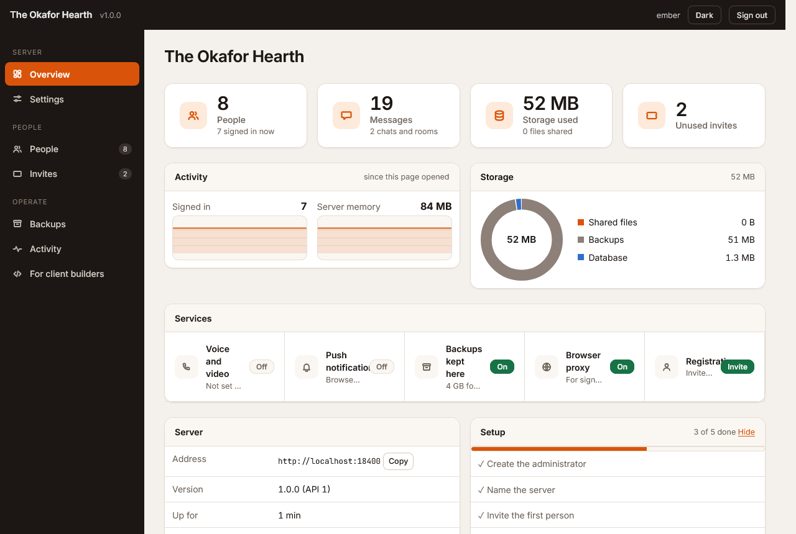
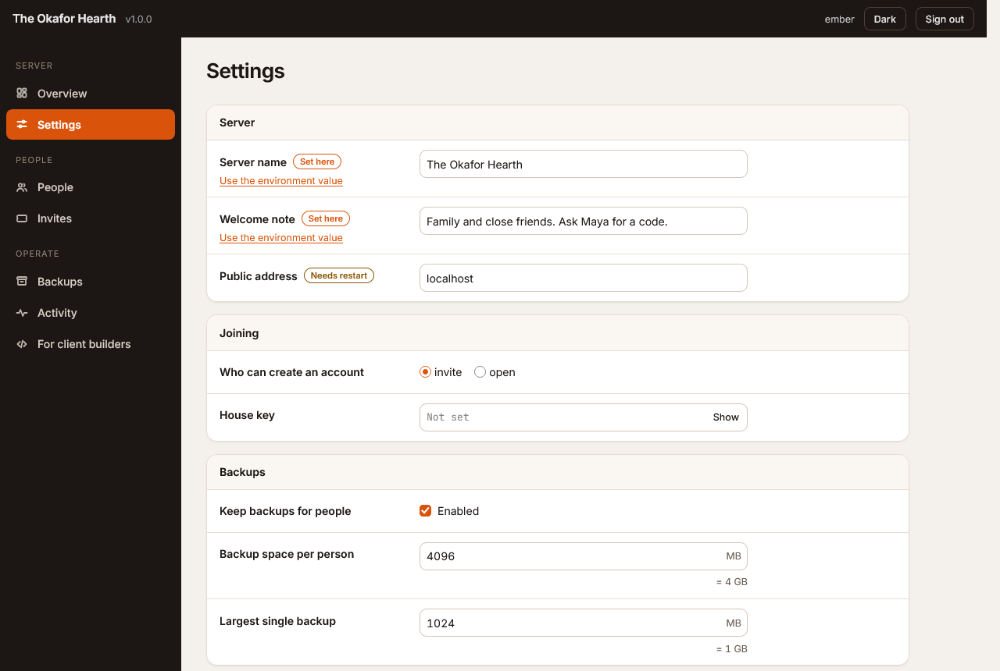
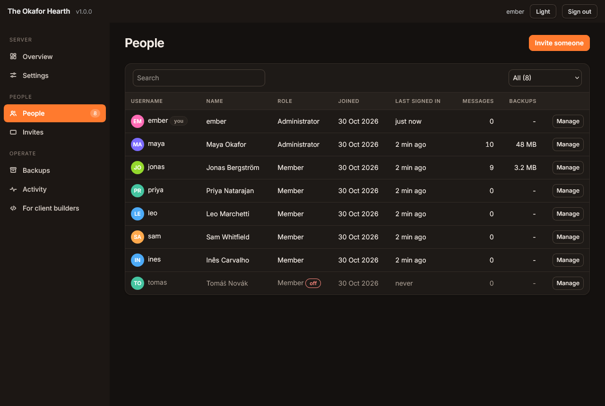

# Hearth server

A small, self-hosted messaging server for a family, a friend group or a team. Accounts, chats and groups, voice and video calls, file sharing, end-to-end encrypted rooms, push notifications, and backups that people keep on *your* server. It comes with a web admin panel for configuring it.

This is the server only. It has **no bundled client**. Clients talk to it over a documented HTTP and WebSocket API, so anyone can write one:

- **Ember**, the native Android client: <https://github.com/modnite/ember-android>
- the Hearth web app and PWA
- yours: see [docs/API.md](docs/API.md)

You do not have to run the one big Hearth server somebody else runs. Run your own. Your accounts, messages, files and backups stay on your machine.

## Run it

You need Docker with Compose. The whole stack is one file:

```sh
curl -fsSLO https://raw.githubusercontent.com/modnite/hearth-server/main/compose.yml
docker compose up -d
```

That starts the server and LiveKit (voice and video). There is no `.env` to write and nothing else to download: an init step makes the LiveKit key and its configuration, the server makes its own session secret, and clients are told where to reach calls from the address they connected by. Open <http://localhost:8080/admin>, make the first administrator, and point your client at the address on the Overview page.

Calls need two things:

1. **Forward the ports.** On your router, forward `7881/tcp` and `50100-50199/udp` to this machine.
2. **HTTPS, for browsers.** Point a domain at the machine and run `HEARTH_DOMAIN=chat.example.com docker compose --profile tls up -d`. Native apps such as Ember do not need it.

No calls wanted, or on Docker Desktop (Windows, macOS), which has no host networking for LiveKit: `docker compose up -d hearth`.

> Calls between two real clients on this stack are not tested yet. Chat, groups, backups and the panel are.

Data is in two Docker volumes, `hearth_data` (the database, files, backups, panel settings, session secret) and `hearth_shared` (LiveKit's key and configuration). Back up `hearth_data`.

## The admin panel (`/admin`)



<p>


</p>

| Tab | What it does |
|---|---|
| Overview | Connect address, people and message counts, storage, whether calls and push work, warnings (default secret, open registration), restart button |
| Settings | Server name, welcome note, who can join, house key, backup space, the built-in browser proxy, LiveKit, web push. Marks which changes apply at once and which need a restart. Saved in the data folder; environment variables stay the fallback |
| People | Make or remove administrators, switch accounts off and on, reset a password (a temporary one is shown once), remove an account |
| Invites | Make and revoke invite codes |
| Backups | Who keeps backups here, how much, delete one |
| Activity | What administrators did |
| For client builders | The server's capabilities and the full route list |

A system-administration page in the spirit of OMV and Cockpit, set in Inter with warm tones, served by the server itself: dark sidebar, stat tiles, live graphs, status badges and tables. No build step, no outside requests, light and dark, usable on a phone.

## What is in the box

- **Accounts**: invite codes or a house key, optional open registration, two-step sign-in with an authenticator app, friend codes, contact requests, blocking, per-device "remember me".
- **Chats**: direct and group chats, replies, reactions, pins, forwarding, search, file and voice-note sharing, archived chats, end-to-end encrypted rooms.
- **Calls**: voice and video through LiveKit, one-to-one and group, with ringing.
- **Notifications**: web push, plus a long-poll channel for native apps without Google services.
- **Backups kept for people**: sealed by the client, stored per person with a quota you set. The server cannot read them.
- **Admin panel and API** as above.

## Everything is in one folder

The server keeps all its state in one data folder (the `hearth_data` volume in Docker): a SQLite database, uploaded files, backups and the panel's `config.json`. Back that folder up and you have backed up the server.

```sh
docker run --rm -v hearth_hearth_data:/data -v "$PWD":/out alpine tar czf /out/hearth-data.tgz -C /data .
```

## Develop

```sh
cd server
npm ci
npm test                 # unit tests
npm run dev              # the server with auto reload on http://localhost:8080
npm run build && node scripts/smoke.mjs http://localhost:8080   # end-to-end check of a running server with an empty data folder
```

On Windows with Node 24, better-sqlite3 can crash when it garbage-collects a prepared statement. Run with the helper that keeps them alive: `node --import ./scripts/keep-statements.mjs dist/index.js`, and for the tests `NODE_OPTIONS=--import=file:///path/to/server/scripts/keep-statements.mjs npx vitest run`. The Docker image and CI use Node 22 and do not need it.

## Upgrading

```sh
git pull
docker compose up -d --build
```

The database migrates itself. Take a copy of the data folder first if the data matters.

## License

MIT. See [LICENSE](LICENSE).
