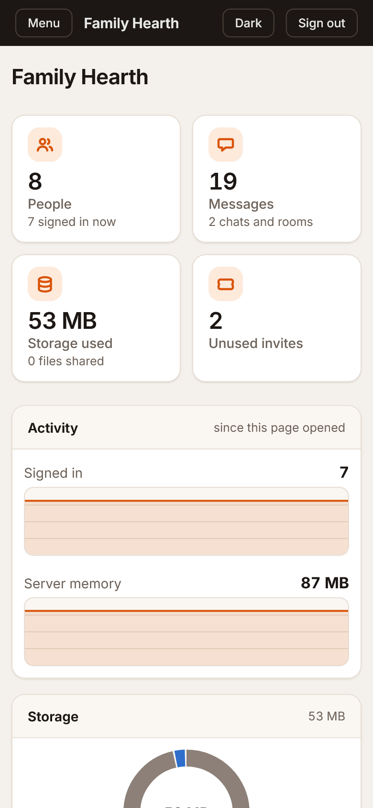
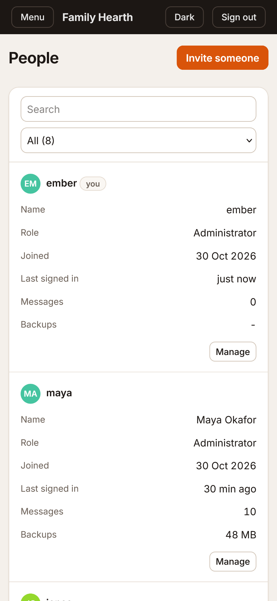
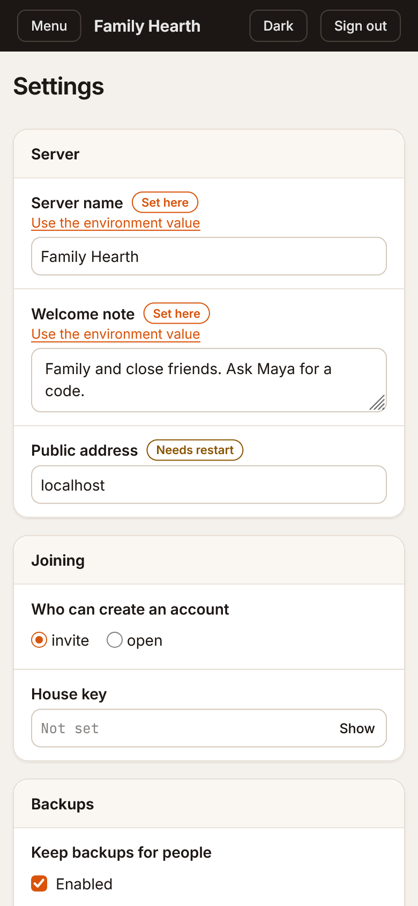
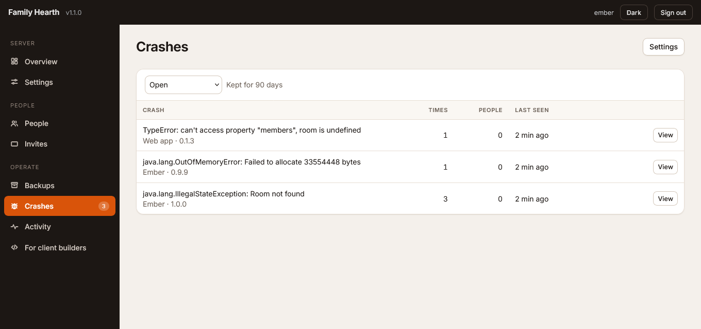
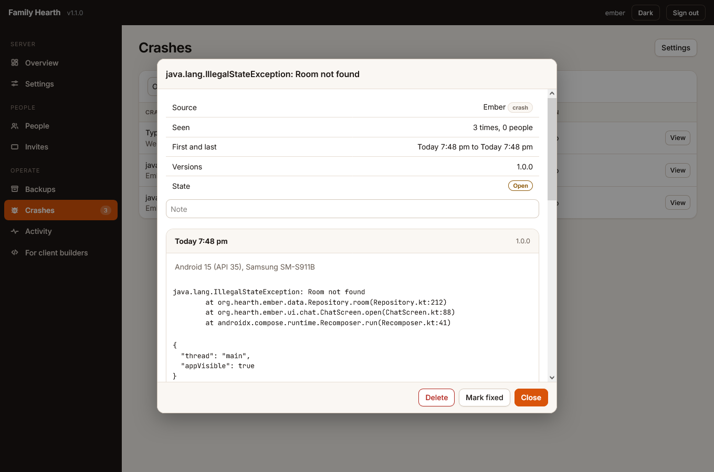
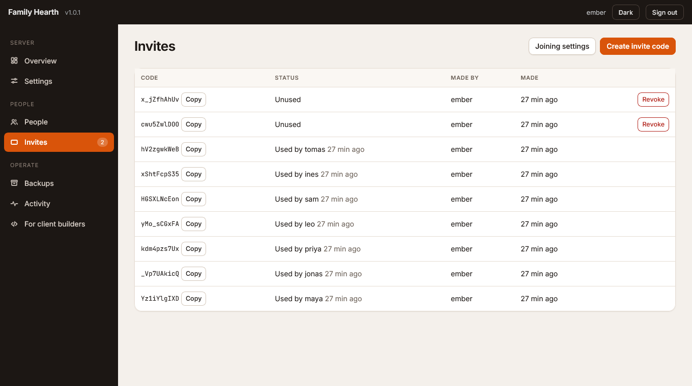
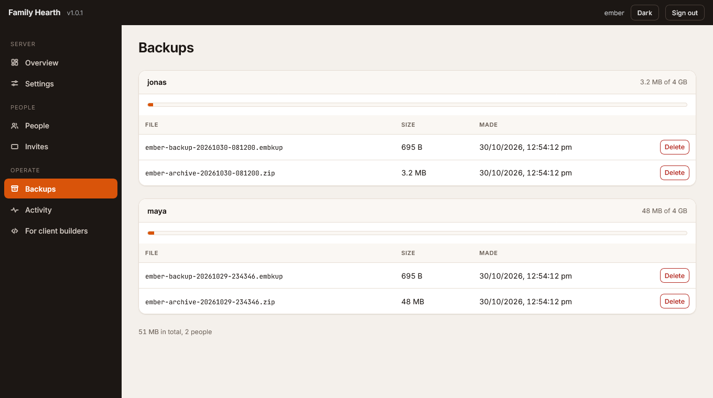
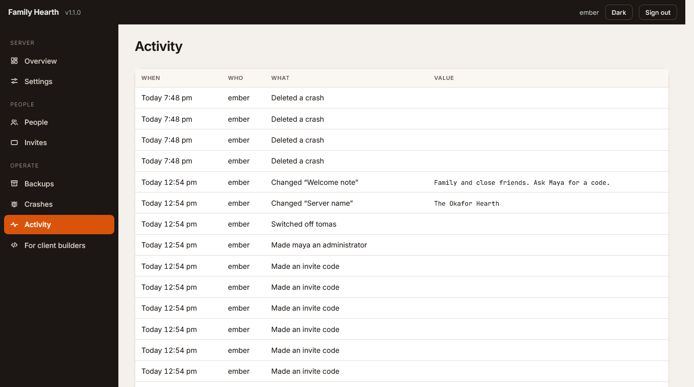
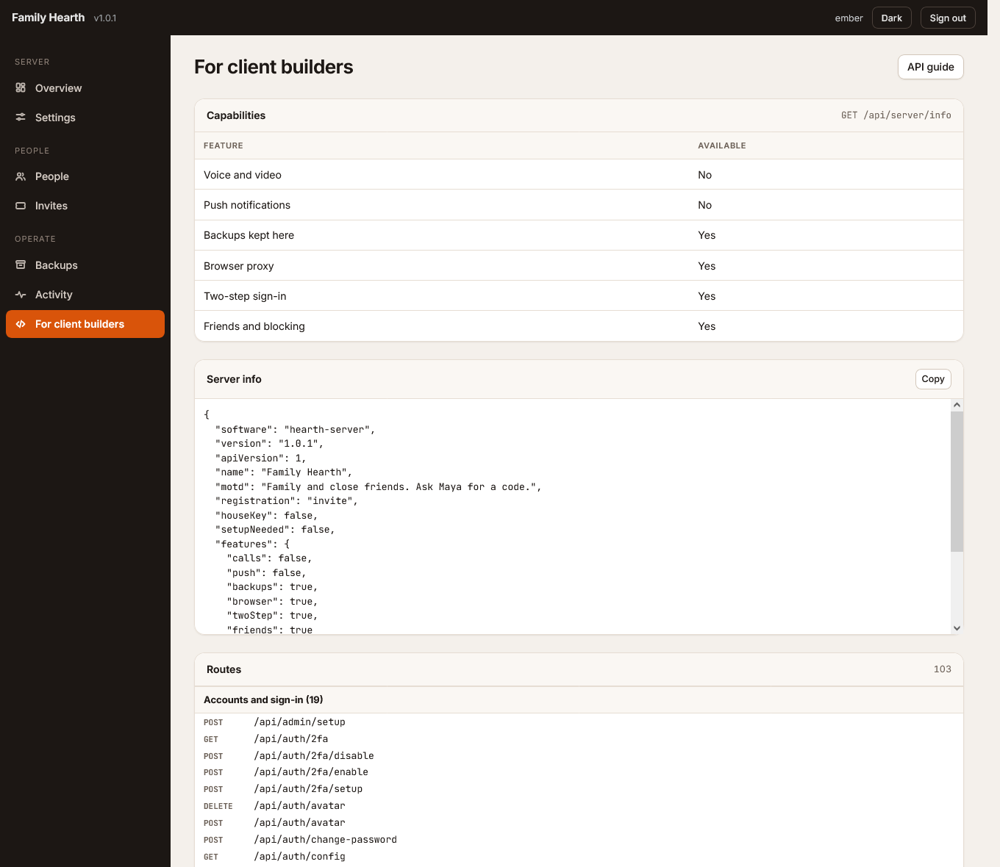

# Hearth server

Self-hosted messaging server for a family, a friend group or a team. Accounts, direct and group chats, voice and video calls, file sharing, end-to-end encrypted rooms, backups kept per person, and a web admin panel. Current version: 1.1.1.

The repository is the server only. Clients use the documented HTTP and WebSocket API ([docs/API.md](docs/API.md)):

- [Ember](https://github.com/modnite/ember-android), the native Android client
- the Hearth web app
- your own


<p>


</p>
<p>



</p>
<p>


</p>

## Run it

Needs Docker with Compose. The stack is one file.

```sh
curl -fsSLO https://raw.githubusercontent.com/modnite/hearth-server/main/compose.yml
docker compose up -d
```

Open <http://localhost:8080/admin>, create the first administrator, and point a client at the address shown on the Overview page.

Services in the file:

| Service | Purpose |
|---|---|
| `init` | Runs once. Makes LiveKit's key and configuration and finds this machine's public address |
| `hearth` | The server and the admin panel |
| `livekit` | Voice and video (host networking, Linux) |
| `caddy` | HTTPS for `HEARTH_DOMAIN`. Only with `--profile tls` |

The server makes its own session secret on first start. Clients are told where to reach calls from the address they connected by.

**Calls** need `7881/tcp` and `50100-50199/udp` forwarded to the machine.

**Browsers** need HTTPS for camera and microphone: `HEARTH_DOMAIN=chat.example.com docker compose --profile tls up -d`. Native apps do not.

**Without calls**, or on Docker Desktop (no host networking): `docker compose up -d hearth`.

Everything else about deploying is in [docs/DEPLOY.md](docs/DEPLOY.md): reverse proxies, configuration, moving machines, upgrades, troubleshooting.

## Admin panel

Served at `/admin` by the server itself. Plain ES modules served as they are, light and dark themes, usable on a phone. It makes no requests to other sites.

<p>




</p>

| Page | Contents |
|---|---|
| Overview | Connect address, counts, storage, live graphs, service status, warnings, setup list, restart button |
| Settings | Server name, welcome note, who can join, house key, backup limits, browser proxy, LiveKit, web push. Marks which changes apply at once and which need a restart |
| People | Make or remove administrators, switch accounts off and on, reset a password, remove an account |
| Invites | Make and revoke invite codes |
| Backups | Who keeps backups here, how much, delete one |
| Crashes | Crash reports from Ember and the web app, grouped by cause, with stacks and device details. Mark one fixed (a new report reopens it), add a note, copy a report, delete |
| Activity | What administrators did |
| For client builders | Server capabilities and the full route list |

Settings are saved to `config.json` in the data folder. An environment variable is the fallback for each one.

## Features

- **Accounts:** invite codes, a house key, or open registration. Two-step sign-in with an authenticator app. Friend codes, contact requests, blocking, remember-this-device.
- **Chats:** direct and group chats, replies, reactions, pins, forwarding, search, files, voice notes, archived chats, end-to-end encrypted rooms.
- **Groups:** any member can add their own contacts and rename the group. Only the person who made it can remove people. If the maker leaves, the group passes to whoever has been in it longest.
- **Calls:** voice and video through LiveKit, one-to-one and group, with ringing.
- **Notifications:** web push, and a long-poll channel for native apps without Google services.
- **Backups:** sealed by the client, stored per person under a quota you set. The server cannot read them.
- **Browser proxy:** optional built-in page fetcher for signed-in people.
- **Crash reports:** clients send their crash logs to `POST /api/crash-reports` and an administrator reviews them under Crashes. Reports are grouped by exception type and top frames, rate limited per address, and deleted after 90 days (Settings, Crash reports). Switch collecting off with the same setting or `CRASH_REPORTS=off`.

## Data

All state is in one folder, the `hearth_data` volume in Docker: SQLite database, uploads, backups, `config.json`, session secret. Back that up and the server is backed up.

```sh
docker run --rm -v hearth_hearth_data:/data -v "$PWD":/out alpine tar czf /out/hearth-data.tgz -C /data .
```

## Develop

```sh
cd server
npm ci
npm test                  # unit tests
npm run dev               # http://localhost:8080 with auto reload
npm run build && node scripts/smoke.mjs http://localhost:8080
```

`smoke.mjs` runs 19 end-to-end checks against a running server with an empty data folder. CI runs the typecheck, the unit tests, the smoke test, builds the image, starts the whole stack from `compose.yml`, runs the smoke test against it, checks that calls are set up and reachable, and checks that data survives a restart. A pushed `v*` tag publishes `ghcr.io/modnite/hearth-server`.

On Windows with Node 24, better-sqlite3 can crash when it garbage-collects a prepared statement. Run with `node --import ./scripts/keep-statements.mjs dist/index.js`, and for tests set `NODE_OPTIONS=--import=file:///path/to/server/scripts/keep-statements.mjs`. The Docker image and CI use Node 22.

Administrator recovery without the panel: `docker compose exec hearth node scripts/admin-cli.mjs list | make-admin <user> | reset-password <user>`.

## Upgrading

```sh
git pull && docker compose up -d --build
```

Or set `HEARTH_IMAGE` to a published image tag. The database migrates itself. Copy the data folder first if the data matters.

## Milestones

| Version | Scope | State |
|---|---|---|
| 1.0.0 | Standalone server, config layer, admin panel, Docker image, API docs | Done |
| 1.0.0 | Group management (add, remove, rename, hand over) | Done |
| 1.0.0 | One-file stack with LiveKit and optional Caddy | Done |
| 1.0.1 | Admin panel refined: even grids, phone layout as cards, dismiss button | Done |
| 1.1.0 | Crash reports: ingest route, Crashes page, retention, settings | Done |
| 1.1.1 | Admin panel: secret settings share one pattern (Set, Replace, Clear) | Done |

### Open items

- [ ] A call between two real clients on this stack (chat, groups, backups and the panel are tested, calls are not)
- [ ] Certificate issuance by Caddy on a real domain
- [ ] The stack on Docker Desktop (Windows, macOS), where only the `hearth` service runs
- [ ] Graph history kept by the server (the Overview graphs only cover the time the page has been open)
- [ ] Group add, remove and rename in the Hearth web client (Ember has them)
- [ ] GitHub release entries for tags (images are published, the release pages are not written)
- [ ] Crash reports from a second real phone (Ember on the emulator is verified end to end)
- [ ] A notification when a new crash appears (the Crashes count in the menu is the only signal)

## Documents

- [docs/DEPLOY.md](docs/DEPLOY.md)
- [docs/API.md](docs/API.md)
- [CHANGELOG.md](CHANGELOG.md)

## License

MIT. See [LICENSE](LICENSE).
